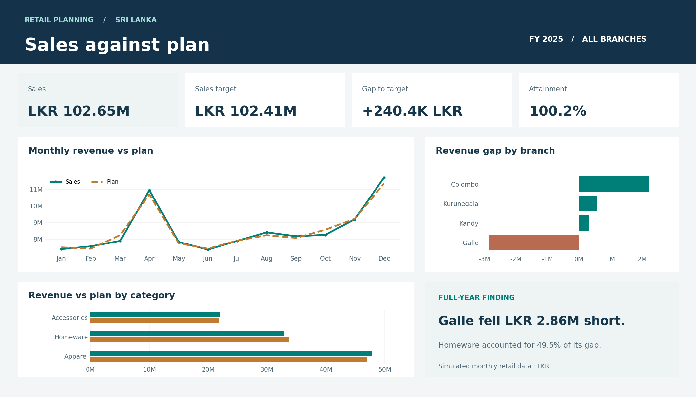

# Sri Lanka retail | Sales and target performance

A portfolio case study using simulated 2025 monthly results for four Sri Lankan branches. All monetary values are in LKR. Each of the 144 records represents one month, branch and product category. Actuals and targets share the same grain, so each target is counted once.

## Open on Windows
1. Extract the complete ZIP into a short local folder, such as C:\BI\Retail. Keep the .Report and .SemanticModel folders beside Retail.pbip.
2. Open Retail.pbip with Microsoft Power BI Desktop. Select Home > Refresh to populate the local import model. If your Desktop version offers project formats under Preview features, enable the relevant Power BI Project and enhanced report format options, restart and reopen.
3. Use Sales against plan for the monthly trend and branch gaps. Select Galle in the branch slicer, then clear it with the eraser to restore all branches.
4. Open Profit and product mix. Select Homeware to see its margin and branch breakdown. Filters on this page are independent of page one.
5. For a single-file portfolio copy, use File > Save As and choose Power BI Desktop file (.pbix).

## What the data shows
- Sales reached LKR 102,645,880 against LKR 102,405,500 planned (100.2% attainment).
- Galle had the largest shortfall, LKR 2,856,536. In that branch, Homeware contributed LKR 1,413,967 of the shortfall (49.5%). A planner could review this category's units and pricing before revising its next target. These aggregates cannot establish why sales missed plan.
- Gross profit was LKR 37,030,709, giving a weighted gross margin of 36.1%. Units sold totalled 55,122.

## How to explain the model
The Power Query import reads an embedded copy of MonthlySales.csv and assigns field types. The separate CSV is for inspection. Editing that file alone will not change the embedded model. Month uses YYYY-MM text so chronological and alphabetical order match. Revenue is net sales, cost is cost of goods sold, and target is planned revenue.
DAX recalculates each KPI for the selected branch or category. Attainment divides total sales by total target, so a small branch and a large branch receive the right weight.

## Measures
- Sales = SUM(SalesPlan[RevenueLKR])
- Sales Target = SUM(SalesPlan[TargetLKR])
- Gap to Target = [Sales] - [Sales Target]
- Attainment = DIVIDE([Sales], [Sales Target])
- Gross Profit = [Sales] - SUM(SalesPlan[CostLKR])
- Gross Margin = DIVIDE([Gross Profit], [Sales])
- Units Sold = SUM(SalesPlan[Units])